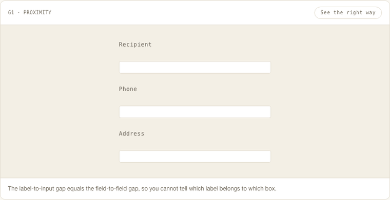

<p align="center">
  <a href="https://javabytm.github.io/gestalt-ui/">
    
  </a>
</p>

<h1 align="center">gestalt-ui</h1>

<p align="center">
  <b>同样的字段、同样的文字、同样的配色——只改了间距，分组就变了。<br>
  九条知觉组织律，每条都落成一个 AI 能算的数。</b>
</p>

<p align="center">
  <a href="https://github.com/javabytm/gestalt-ui/releases"></a>
  <a href="LICENSE"></a>
  
  
  
  
</p>

<p align="center">
  <a href="https://javabytm.github.io/gestalt-ui/"><b>▶ 在线演示</b></a> ·
  <a href="#装到哪">装到哪</a> ·
  <a href="#它永远不会告诉你的事">边界</a> ·
  <a href="README.md">English</a>
</p>

---

## 一句话说清问题

AI 生成的页面，很少是"跑不起来"败掉的。败在读者还没读到第一个字，知觉就把它归档成**一大坨灰**：间距均匀铺开、容器一层套一层、所有标签同一个字号同一档灰度。

知觉**先分组、后阅读**。所以"一看就是 AI 做的"，通常不是配色问题，是**分组信号缺失**。

## 它到底是什么

纯 Markdown（`SKILL.md` ＋ `references/`，按卡逐份加载，无运行时、无依赖），把格式塔的描述性定律变成 Agent 能执行、能核对的约束：

- **每条律一个 0–100 的公式**，能指到具体 CSS 值：间距比、字号级差、描边宽度、明度差、动效时长。
- **测不到不等于 0 分。** 缺结构信息的条目标 `N/A` 并移出分母——"我没测到"永远不伪装成"它不合格"。
- **三条固定流程**（做 / 评 / 改）：动 CSS 之前先看影响面，动完必须复量。

## 30 秒试一下

1. **看**：打开[在线演示](https://javabytm.github.io/gestalt-ui/)，随便挑一条原理，在"违背它 / 遵守它"之间切一下——每次只动一个变量。
2. **评**：把任意 HTML 贴进页面底部的评估器，它读 DOM，给出总分与九条明细。
3. **装**：复制 `SKILL.md` 与 `references/`（见下），然后对 Agent 说"给这页打分，把最该改的三处改掉"。

## 三种用法

| 你说 | 走哪张卡 | 你拿到 |
|---|---|---|
| "帮我做个页面 / 这页怎么排" | 生成卡——五步，先定骨架，**这一步禁止碰颜色** | 一版结构成立的页面 + 假设说明 |
| "看看这页 / 打个分 / 哪里看着乱" | 评估卡——五步，不跳步 | 总分 + 九条明细 + 最该改的三处 + 边界声明 |
| "这版太乱帮我改" | 改造卡——执行型 / 诊断型两个入口 | 改动清单 + hit/miss + 复量对比 |

## 打分怎么算

九条定律，权重固定：

| 定律 | G1 接近 | G4 连续 | G5 共同区域 | G2 相似 | G9 简洁 | G7 图底 | G3 闭合 | G6 连接 | G8 共同命运 |
|---|---|---|---|---|---|---|---|---|---|
| 权重 | 18 | 16 | 14 | 12 | 12 | 10 | 8 | 5 | 5 |

`总分 = Σ(单条得分 × 权重) ÷ Σ(参与计分的权重)`——有定律不适用时分母自动变小，分数仍是 0–100。

**宿主能力决定能测几条，而且报告必须声明是哪一种读数：**

| 宿主能做什么 | 能测到 | 怎么报 |
|---|---|---|
| 会看图（只有截图） | 三条：间距节奏、对比度、通道预算 | 报区间，不报小数 |
| 会开浏览器 / 会读 HTML | 九条 | 报精确值 |
| 都不会 | 取决于口述能填几项 | 其余标 N/A |

唯一不能让的一条：**不把"估"写成"量"**。

## 装到哪

`SKILL.md` ＋ `references/` 就是全部规则——纯 Markdown，无运行时、无依赖。
`SKILL.md` 放选卡表、开场白与共享判据（通道 token、九条原理、自检九问）；
每张卡的工作细则各占 `references/` 下一个文件，只在用到那张卡时读。

```bash
# Claude Code —— references/ 必须与 SKILL.md 同级（指针是相对技能根目录写的）
mkdir -p ~/.claude/skills/gestalt-ui && cp -R SKILL.md references ~/.claude/skills/gestalt-ui/

# 其他支持 Agent Skills 的宿主：放进该宿主的 skills 目录
# （Codex / Cursor 等按各自约定；关键是 references/ 与 SKILL.md 保持同级）

# Cursor / Codex / 其它宿主：把 SKILL.md 贴进规则，references/ 一并放好
# （AGENTS.md / .cursorrules / 系统提示，只要模型读得到就行）
```

技能靠 `name` + `description` 被自动命中；宿主支持显式调用时，直接点名 `gestalt-ui`。

> **语言说明**：技能正文是中文写的。公式、token、阈值本身与语言无关——英文版可以做，但那会变成第二份需要同步的源，所以暂时只出中文。需要就开 issue。

## 实测，不是自评

在一份约 10 500 px 高的经营分析报告页上（1440×900，DOM 实测）：

| | 改造前 | 改造后 |
|---|---|---|
| 总分 | 61.4（分母 95，G6 不适用） | **78.4**（分母 100） |
| G3 闭合 | 0 | 96 |
| G8 共同命运 | 47 | 100 |
| G1 接近 | 55 | 80 |
| G4 连续 | 96 | 92（**唯一退步项**——字体重映射带动基线位移） |

改造方式是 CSS 文本层值域重映射：规则级替换 + 字号 / 字重 / 圆角 / 间距四类全局重映射，脚本可重跑、可审计，不是手工调出来的。

## 它永远不会告诉你的事

- **审美。** 分数是结构下限筛子，不是"好看"的判据。78 分不代表用户觉得舒服。
- **字体渲染、屏幕色彩管理、环境光、动效手感、色觉异常。** 这些不在 DOM 数值里。
- **内容对不对。** 它只评版式，不判断页面里的数据与口径。
- **平台强制色。** 业务要求分类编码色时，通道预算会制度性超支，G9 可能永远到不了高分——取舍，不是缺陷。

## 仓库结构

```
.
├── SKILL.md              # 入口：选卡表 + 共享判据（通道 token、九条原理、自检九问）
├── references/           # 每张卡的细则，只在用到该卡时读
│   ├── generate.md       # 生成卡：内容 → 骨架 → 分组 → 通道 → 自检
│   ├── evaluate.md       # 评估卡：五步 + 最小事实集 + 九条公式
│   └── refactor.md       # 改造卡：两入口 + 影响面表 + 急救表
├── demo/
│   ├── index.html        # 交互作品：九条原理的对照实验 + DOM 评估器（单文件，断网可用）
│   ├── i18n/             # zh（键表）+ en / ja / ko 译文
│   ├── build_i18n.py     # 校验齐备后注入页面
│   ├── check_i18n.py     # 交付闸：字典齐备 + 逐语言无头渲染查残留
│   └── screenshots/
├── README.zh-CN.md
└── README.md
```

`demo/index.html` 里的评估器是"最精确那条路"的参考实现；技能本身不依赖它——会开浏览器、会读 HTML、只能看图，三种宿主都能按协议给出对应精度的结论。

## 多语言

演示页有**中文（源语言）/ 英文 / 日文 / 韩文**四种，顶栏下拉切换，也支持 `?lang=en|ja|ko`。技能正文保持中文。

文案不在 `index.html` 里手改，而在 `demo/i18n/<语言>.json`，键就是中文原文：

```bash
python3 demo/build_i18n.py   # 校验齐备后注入页面
python3 demo/check_i18n.py   # 闸：全语言齐备 + 逐语言实跑无残留中文
```

缺键、多键、占位符不一致，构建直接失败；哪个语言还渲染出中文，闸直接失败。加语言 = 一个 JSON + 一个 `LANGS` 条目 + 一个 `<option>`。

## 许可

MIT，见 [LICENSE](LICENSE)。可自由使用、修改、再分发与商用，保留版权声明即可。点个 star 或注明出处是情分，不是义务。

---

<p align="center">
  <sub>如果它帮你省掉了一轮返工，点个 ⭐ 能让下一个人也找到它。</sub>
</p>
